<!-- Generated by profile/readme.mjs from profile/content.mjs. The images are built by .github/workflows/profile.yml. -->

<a href="https://joaquimcolacilli-portfolio.netlify.app/"><picture><source media="(max-width: 560px)" srcset="https://raw.githubusercontent.com/JoaquimColacilli/JoaquimColacilli/output/hero-compact.svg"><source media="(prefers-color-scheme: dark)" srcset="https://raw.githubusercontent.com/JoaquimColacilli/JoaquimColacilli/output/hero-dark.svg"></picture></a> 
<a href="https://joaquimcolacilli-portfolio.netlify.app/"><picture><source media="(max-width: 560px)" srcset="https://raw.githubusercontent.com/JoaquimColacilli/JoaquimColacilli/output/link-portfolio-compact.svg"><source media="(prefers-color-scheme: dark)" srcset="https://raw.githubusercontent.com/JoaquimColacilli/JoaquimColacilli/output/link-portfolio-dark.svg"></picture></a><a href="https://www.linkedin.com/in/joaquim-colacilli/"><picture><source media="(max-width: 560px)" srcset="https://raw.githubusercontent.com/JoaquimColacilli/JoaquimColacilli/output/link-linkedin-compact.svg"><source media="(prefers-color-scheme: dark)" srcset="https://raw.githubusercontent.com/JoaquimColacilli/JoaquimColacilli/output/link-linkedin-dark.svg"></picture></a><a href="mailto:joaquimcolacilli9@gmail.com"><picture><source media="(max-width: 560px)" srcset="https://raw.githubusercontent.com/JoaquimColacilli/JoaquimColacilli/output/link-email-compact.svg"><source media="(prefers-color-scheme: dark)" srcset="https://raw.githubusercontent.com/JoaquimColacilli/JoaquimColacilli/output/link-email-dark.svg"></picture></a> 
<picture><source media="(max-width: 560px)" srcset="https://raw.githubusercontent.com/JoaquimColacilli/JoaquimColacilli/output/section-stack-compact.svg"><source media="(prefers-color-scheme: dark)" srcset="https://raw.githubusercontent.com/JoaquimColacilli/JoaquimColacilli/output/section-stack-dark.svg"></picture> 
<picture><source media="(max-width: 560px)" srcset="https://raw.githubusercontent.com/JoaquimColacilli/JoaquimColacilli/output/stack-compact.svg"><source media="(prefers-color-scheme: dark)" srcset="https://raw.githubusercontent.com/JoaquimColacilli/JoaquimColacilli/output/stack-dark.svg"></picture> 
<picture><source media="(max-width: 560px)" srcset="https://raw.githubusercontent.com/JoaquimColacilli/JoaquimColacilli/output/section-experience-compact.svg"><source media="(prefers-color-scheme: dark)" srcset="https://raw.githubusercontent.com/JoaquimColacilli/JoaquimColacilli/output/section-experience-dark.svg"></picture> 
<a href="https://www.linkedin.com/in/joaquim-colacilli/"><picture><source media="(max-width: 560px)" srcset="https://raw.githubusercontent.com/JoaquimColacilli/JoaquimColacilli/output/experience-compact.svg"><source media="(prefers-color-scheme: dark)" srcset="https://raw.githubusercontent.com/JoaquimColacilli/JoaquimColacilli/output/experience-dark.svg"></picture></a> 
<picture><source media="(max-width: 560px)" srcset="https://raw.githubusercontent.com/JoaquimColacilli/JoaquimColacilli/output/section-work-compact.svg"><source media="(prefers-color-scheme: dark)" srcset="https://raw.githubusercontent.com/JoaquimColacilli/JoaquimColacilli/output/section-work-dark.svg"></picture> 
<a href="https://primatech.com.ar/"><picture><source media="(max-width: 560px)" srcset="https://raw.githubusercontent.com/JoaquimColacilli/JoaquimColacilli/output/work-primatech-compact.svg"><source media="(prefers-color-scheme: dark)" srcset="https://raw.githubusercontent.com/JoaquimColacilli/JoaquimColacilli/output/work-primatech-dark.svg"></picture></a><a href="https://bramelec.com/"><picture><source media="(max-width: 560px)" srcset="https://raw.githubusercontent.com/JoaquimColacilli/JoaquimColacilli/output/work-bramelec-compact.svg"><source media="(prefers-color-scheme: dark)" srcset="https://raw.githubusercontent.com/JoaquimColacilli/JoaquimColacilli/output/work-bramelec-dark.svg"></picture></a> 
<a href="https://el-calculetas.netlify.app"><picture><source media="(max-width: 560px)" srcset="https://raw.githubusercontent.com/JoaquimColacilli/JoaquimColacilli/output/work-el-calculetas-compact.svg"><source media="(prefers-color-scheme: dark)" srcset="https://raw.githubusercontent.com/JoaquimColacilli/JoaquimColacilli/output/work-el-calculetas-dark.svg"></picture></a><a href="https://joaquimcolacilli.github.io/estimador-desarrollo/"><picture><source media="(max-width: 560px)" srcset="https://raw.githubusercontent.com/JoaquimColacilli/JoaquimColacilli/output/work-estimador-desarrollo-compact.svg"><source media="(prefers-color-scheme: dark)" srcset="https://raw.githubusercontent.com/JoaquimColacilli/JoaquimColacilli/output/work-estimador-desarrollo-dark.svg"></picture></a> 
<a href="https://joaquimcolacilli.github.io/checklistwf3/"><picture><source media="(max-width: 560px)" srcset="https://raw.githubusercontent.com/JoaquimColacilli/JoaquimColacilli/output/work-checklistwf3-compact.svg"><source media="(prefers-color-scheme: dark)" srcset="https://raw.githubusercontent.com/JoaquimColacilli/JoaquimColacilli/output/work-checklistwf3-dark.svg"></picture></a><a href="https://joaquimcolacilli.github.io/playertimer/"><picture><source media="(max-width: 560px)" srcset="https://raw.githubusercontent.com/JoaquimColacilli/JoaquimColacilli/output/work-playertimer-compact.svg"><source media="(prefers-color-scheme: dark)" srcset="https://raw.githubusercontent.com/JoaquimColacilli/JoaquimColacilli/output/work-playertimer-dark.svg"></picture></a> 
<a href="https://github.com/JoaquimColacilli/json-parser-exec"><picture><source media="(max-width: 560px)" srcset="https://raw.githubusercontent.com/JoaquimColacilli/JoaquimColacilli/output/work-json-parser-exec-compact.svg"><source media="(prefers-color-scheme: dark)" srcset="https://raw.githubusercontent.com/JoaquimColacilli/JoaquimColacilli/output/work-json-parser-exec-dark.svg"></picture></a><a href="https://joaquimcolacilli.github.io/wpf/"><picture><source media="(max-width: 560px)" srcset="https://raw.githubusercontent.com/JoaquimColacilli/JoaquimColacilli/output/work-wpf-compact.svg"><source media="(prefers-color-scheme: dark)" srcset="https://raw.githubusercontent.com/JoaquimColacilli/JoaquimColacilli/output/work-wpf-dark.svg"></picture></a> 
<picture><source media="(max-width: 560px)" srcset="https://raw.githubusercontent.com/JoaquimColacilli/JoaquimColacilli/output/section-activity-compact.svg"><source media="(prefers-color-scheme: dark)" srcset="https://raw.githubusercontent.com/JoaquimColacilli/JoaquimColacilli/output/section-activity-dark.svg"></picture> 
<picture><source media="(max-width: 560px)" srcset="https://raw.githubusercontent.com/JoaquimColacilli/JoaquimColacilli/output/activity-compact.svg"><source media="(prefers-color-scheme: dark)" srcset="https://raw.githubusercontent.com/JoaquimColacilli/JoaquimColacilli/output/activity-dark.svg"></picture> 
<picture><source media="(max-width: 560px)" srcset="https://raw.githubusercontent.com/JoaquimColacilli/JoaquimColacilli/output/section-education-compact.svg"><source media="(prefers-color-scheme: dark)" srcset="https://raw.githubusercontent.com/JoaquimColacilli/JoaquimColacilli/output/section-education-dark.svg"></picture> 
<picture><source media="(max-width: 560px)" srcset="https://raw.githubusercontent.com/JoaquimColacilli/JoaquimColacilli/output/education-compact.svg"><source media="(prefers-color-scheme: dark)" srcset="https://raw.githubusercontent.com/JoaquimColacilli/JoaquimColacilli/output/education-dark.svg"></picture> 
<picture><source media="(max-width: 560px)" srcset="https://raw.githubusercontent.com/JoaquimColacilli/JoaquimColacilli/output/footer-compact.svg"><source media="(prefers-color-scheme: dark)" srcset="https://raw.githubusercontent.com/JoaquimColacilli/JoaquimColacilli/output/footer-dark.svg"></picture> 
<a href="https://joaquimcolacilli-portfolio.netlify.app/"><picture><source media="(max-width: 560px)" srcset="https://raw.githubusercontent.com/JoaquimColacilli/JoaquimColacilli/output/link-portfolio-compact.svg"><source media="(prefers-color-scheme: dark)" srcset="https://raw.githubusercontent.com/JoaquimColacilli/JoaquimColacilli/output/link-portfolio-dark.svg"></picture></a><a href="https://www.linkedin.com/in/joaquim-colacilli/"><picture><source media="(max-width: 560px)" srcset="https://raw.githubusercontent.com/JoaquimColacilli/JoaquimColacilli/output/link-linkedin-compact.svg"><source media="(prefers-color-scheme: dark)" srcset="https://raw.githubusercontent.com/JoaquimColacilli/JoaquimColacilli/output/link-linkedin-dark.svg"></picture></a><a href="mailto:joaquimcolacilli9@gmail.com"><picture><source media="(max-width: 560px)" srcset="https://raw.githubusercontent.com/JoaquimColacilli/JoaquimColacilli/output/link-email-compact.svg"><source media="(prefers-color-scheme: dark)" srcset="https://raw.githubusercontent.com/JoaquimColacilli/JoaquimColacilli/output/link-email-dark.svg"></picture></a>

